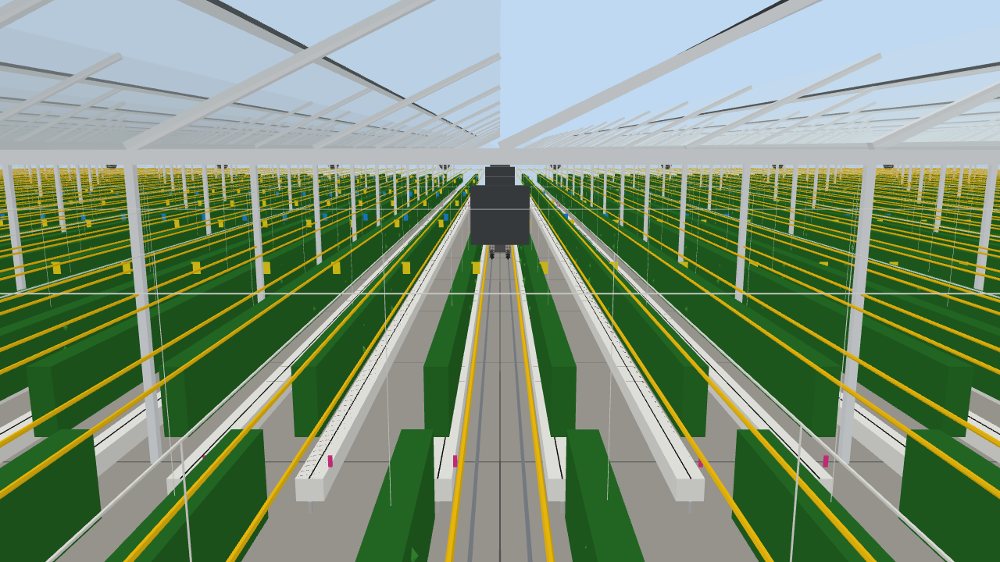
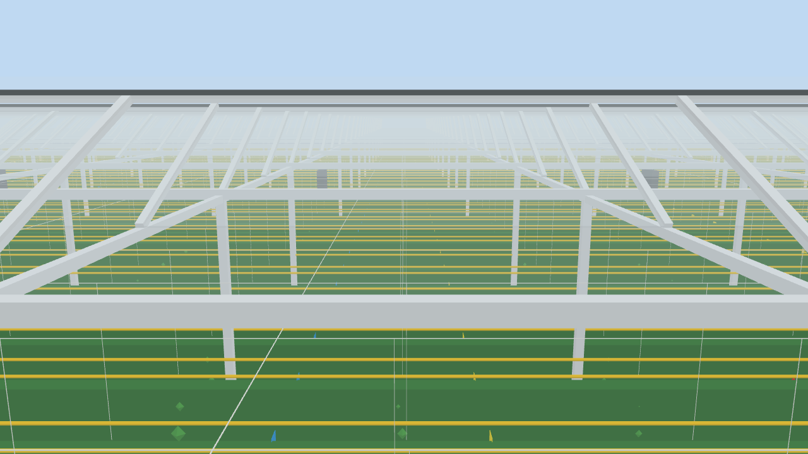

# pepper_greenhouse —— 100×100 m 室内甜椒大棚场景

基于 8 张现场实拍图搭建的 Gazebo Classic 11 场景。这是一个**独立的场景包**，
不依赖任何底盘：任何 ROS 2 机器人/底盘都可以通过 `world:=` 参数，或者用
`gazebo_ros/spawn_entity.py` 生成到这个场景里。

设计取舍是**布局优先**：通道、沟槽、行距、轨道和棚体结构按实拍比例还原；
植株用连续冠层带 + 稀疏低模八面体表示，不做逐株精细模型。headless 下
仿真实时因子接近 1，可直接用于 Nav2/路径验证。

## 尺寸基准：轨道 = 参考底盘轮距

照片里中央通道的两条钢轨是与底盘轨道接口配合的。当前尺寸以仓库里的 4WIS 底盘
作为参考：轮心 `y=±0.33470 m`，因此

```text
轨距 = 2 × 0.33470 = 0.6694 m
```

其余尺寸都由此推算：

| 项目 | 数值 | 说明 |
|---|---:|---|
| 轨道中心 | y=±0.33470 m | 轨距 0.6694 m |
| 轨道截面 | 0.050 × 0.006 m | 5 cm 宽，轮宽 4.49 cm 完全落在轨面；6 mm 高便于爬轨 |
| 车轮外缘 / 轨道外缘 | 0.35715 / 0.35970 m | 车轮不悬空 |
| 中央通道净宽 | 1.20 m | 沟槽内壁 ±0.60 |
| 轮-沟槽间隙 | 0.243 m | 单侧 |
| 沟槽 | 0.35 m 宽，底 0.15 / 顶 0.35 m | 基质面 0.34 |
| 行距 | 1.60 m | 行间走道 1.25 m |
| 每侧行数 | 30 | 最外缘 ±47.35 |
| 侧通道 | 2.60 m | 墙内壁 ±49.95 |
| 棚体 | 100 × 100 m，檐高 4.50 / 脊高 5.70 m | 20 个 5 m 屋面 bay |
| 床区 | x∈[−46, +46]，92 m | 端部掉头区 3.95 m |
| 横向通道 | 2.0 m，中心 x=±22.5 | 柱网 x=20 / 25 之间 |
| 轨道长度 | 94 m，x∈[−47, +47] | 穿过横向通道 |
| 柱网 | 5.0 × 5.0 m，420 根 | y=0 柱线省略，中央通道无柱 |
| 冠层 | z=0.35~0.50 m | 坐在垄上，植株高 0.15 m |
| 吊蔓钢丝 / 黄管 | z=3.80 / 2.50 m | 黄管 118 根 |

床段划分：`22.5 + 2 + 43 + 2 + 22.5 = 92 m`。

`scripts/layout.py` 是唯一尺寸来源，`Layout.validate()` 会断言轨距、
轮轨间隙、行数、通道无柱等约束。换成其它底盘时，先改
`config/greenhouse.yaml` 里的 `chassis.wheel_y` / `wheel_width` / `wheel_radius`，
再重新生成世界（见“重新生成”）。

## 目录

```text
src/pepper_greenhouse/
├── config/greenhouse.yaml          # 所有可调尺寸与密度
├── launch/pepper_greenhouse_world.launch.py   # 独立场景 launch（不生成机器人）
├── models/
│   ├── pepper_greenhouse_shell/    # 白框、玻璃、风扇、黄管、钢丝、地面
│   ├── pepper_beds_mid/            # 43 m 床段
│   ├── pepper_beds_end/            # 22.5 m 床段，东西复用
│   └── pepper_plants_dense/        # visual 档的加密植株覆盖层
├── worlds/
│   ├── pepper_greenhouse.world     # 默认布局档
│   └── pepper_greenhouse_visual.world
├── scripts/
│   ├── layout.py                   # dataclass + 派生尺寸 + validate
│   ├── generate_world.py           # 生成 world/model/二进制 STL
│   ├── check_layout.py             # 尺寸与资产检查
│   └── save_camera_frame.py        # 保存一帧巡检相机图像
└── test/test_generated_assets.py
```

## 编译与运行

```bash
cd <本仓库根目录>
colcon build --symlink-install --packages-select pepper_greenhouse
source install/setup.bash

# 默认布局档（headless，推荐给 Nav2/路径验证）
ros2 launch pepper_greenhouse pepper_greenhouse_world.launch.py gui:=false

# GUI 看布局
ros2 launch pepper_greenhouse pepper_greenhouse_world.launch.py

# 加密植株视觉档
ros2 launch pepper_greenhouse pepper_greenhouse_world.launch.py profile:=visual gui:=true

# 暂停启动，方便先摆相机/机器人
ros2 launch pepper_greenhouse pepper_greenhouse_world.launch.py pause:=true
```

启动参数：

| 参数 | 默认 | 说明 |
|---|---|---|
| `profile` | `layout` | `layout` 或 `visual` |
| `gui` | `true` | 是否启动 gzclient |
| `verbose` | `false` | gzserver 详细输出 |
| `pause` | `false` | 启动后暂停仿真 |

> 这个 launch **只启动 Gazebo 和 world**，不启动 `robot_state_publisher`、控制器或
> 任何底盘节点。场景中的两台相机由 `gazebo_ros` 插件发布。

## 与底盘/机器人组合

场景包与底盘完全解耦。常用组合方式有三种。

### 方式 1：给底盘 launch 传 `world:=`（推荐）

大多数底盘 launch 都允许指定 world 文件。以本仓库的 4WIS 底盘为例：

```bash
# 需要 pepper_greenhouse 和 steer_wheel_control 在同一个工作空间里
ros2 launch steer_wheel_control sim.launch.py \
  world:=$(ros2 pkg prefix pepper_greenhouse)/share/pepper_greenhouse/worlds/pepper_greenhouse.world
```

`steer_wheel_control/sim.launch.py` 会把 `world` 透传给
`steer_wheel_chassis/gazebo.launch.py`，机器人生成、控制器和里程计都照常启动。
换成其它底盘时，把前面的包名和 launch 名替换成你的底盘入口即可。

### 方式 2：先起场景，再单独生成机器人

```bash
# 终端 1
ros2 launch pepper_greenhouse pepper_greenhouse_world.launch.py gui:=false

# 终端 2：用你的底盘 launch 只做 spawn，或直接调用 spawn_entity
ros2 run gazebo_ros spawn_entity.py \
  -file /path/to/robot.urdf -entity robot -x 0 -y 0 -z 0.02
```

相机、TF、控制器等由你自己的底盘节点负责。

### 方式 3：把两个资源分支放进同一个工作空间

本仓库的资源分支是独立的，需要同时使用时，用 `git worktree` 或复制：

```bash
# 在仓库旁边再检出一个底盘分支
git worktree add ../gazebo-SSR-chassis sim/transfer-robot-chassis

# 把底盘包复制到当前大棚工作空间
cp -a ../gazebo-SSR-chassis/src/steer_wheel_chassis src/
cp -a ../gazebo-SSR-chassis/src/steer_wheel_control src/
cp -a ../gazebo-SSR-chassis/src/steer_wheel_odometry src/

colcon build --symlink-install
source install/setup.bash
```

然后按方式 1 启动。

## 重新生成

尺寸改 `config/greenhouse.yaml` 后：

```bash
python3 src/pepper_greenhouse/scripts/generate_world.py
python3 src/pepper_greenhouse/scripts/check_layout.py

colcon build --symlink-install --packages-select pepper_greenhouse
source install/setup.bash
```

生成物（world / model.sdf / model.config / STL）是提交到源码树的；
`generate_world.py --check` 可不写盘地比对生成物是否与配置一致。

## 预览

`docs/aisle_camera.png`（中央通道，相机在 x=30、朝 −x）和
`docs/bed_camera.png`（跨床区，相机在 (2.5, −18)、朝 +y）都是实际仿真
相机输出：





## 巡检相机

world 里固定放置了两台 1 Hz / 1280×720 的相机（不依赖 TF）：

| 相机 | 位置/朝向 | 话题 |
|---|---|---|
| `aisle_camera` | (30, 0, 4.5)，沿 −x 看中央通道 | `/greenhouse/aisle_camera/image_raw` |
| `bed_camera` | (0, −18, 5.5)，沿 +y 看床区 | `/greenhouse/bed_camera/image_raw` |

保存一帧：

```bash
ros2 run pepper_greenhouse save_camera_frame.py \
  /greenhouse/aisle_camera/image_raw /tmp/aisle.png
ros2 run pepper_greenhouse save_camera_frame.py \
  /greenhouse/bed_camera/image_raw /tmp/bed.png
```

也可以用 `rqt_image_view` 或 `rviz2` 的 Image 显示。

## 模型与性能

- 每个模型把同材质几何合并成一个二进制 STL，整场景约 **45 个 draw call**，
  与植株数量无关。
- 布局档约 **14.6 万三角形**；visual 档约 **30 万三角形**。
- 玻璃只用一个 merged mesh，`transparency=0.80`、`cast_shadows=false`；
  框架/风扇/植株可以投影。
- 物理沿用现有 world：1 ms 步长、1000 Hz、ODE quick 50 iters。
- 碰撞体（world 里共约 1070 个静态碰撞体）：地面 1、轨道 2、沟槽 180、墙 4、
  **屋面 40、立柱 420、冠层 180、风机 25、屋脊通风口 20、黄管 118、吊线 78**。
  这些是雷达点云里可用于重定位的结构特征（冠层是每行一整条 0.3×0.9 m 的
  简化带，不是逐株八面体）。
- 仍为 visual-only：果实/吊绳/卡片/地缝，以及 `visual` 档的密集植株覆盖层
  （对点云贡献很小，全部做成碰撞体会严重拖慢仿真）。
- 注意：Gazebo 的 ray sensor（例如 MID-360 插件）只和 **collision** 求交，
  因此要让雷达看到结构，对应几何必须有 collision。碰撞体都是简化的 box/cylinder
  代理，与视觉 mesh 不完全一致；屋面按檐口 4.5 m / 屋脊 5.7 m 的 40 块斜板生成。
- 并行/阴影在 GUI 下最耗性能；layout 档已经足够轻，visual 档用于截图。

## 已知事项

- **场景里没有机器人**：这是刻意设计。里程计、控制器、雷达都由你使用的底盘包提供；
  本包只负责 world、模型、相机和生成脚本。
- **只有两台固定巡检相机**：照片里的其它相机/机械臂不在本场景范围内。
- **柱网与行距不整除**：柱网 5 m、行距 1.6 m，部分柱子会落在 1.25 m 行间走道；
  中央通道、横向通道、端部掉头区都已断言无柱。立柱有简化碰撞代理，但视觉网格与
  碰撞代理不完全一致。
- **轨道高度可调**：当前 6 mm 高、5 cm 宽。最初用 1 cm 高时，49 kg 的参考底盘
  可以压上去，但从地面横移回来时爬不上 1 cm 台阶；降到 6 mm 后重测。
  如果现场轨道更高，把 `config/greenhouse.yaml` 的 `rails.height` 调回去，
  并给轨道加 45° 倒角碰撞，或接受“只能从轨面开始”。
- **`model://` 依赖**：`package.xml` 通过 `gazebo_model_path="${prefix}/models"`
  导出模型路径，launch 前必须 `source install/setup.bash`。手动 `gzserver world`
  时要补 `GAZEBO_MODEL_PATH`。
- **雷达性能**：场景本身不含雷达；如果底盘带 MID-360，默认 `mid360_samples=10000`
  时大棚 RTF 约 0.38，40000 时只有 0.065。需要更流畅可以把 samples 降到 5000，
  或把 `<update_rate>` 从 10 Hz 降到 5 Hz。
